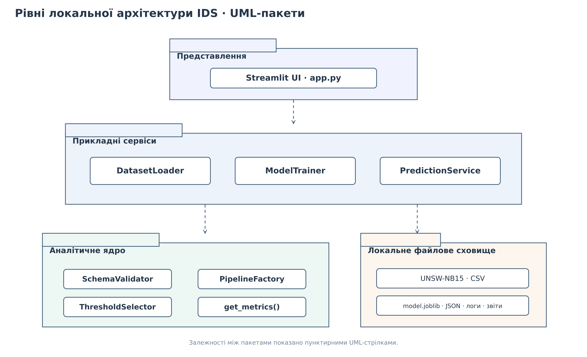

# Розробка системи виявлення вторгнень (IDS)

**Магістерський проєкт.** Локальний Python/Streamlit-прототип для двокласової класифікації попередньо обчислених характеристик мережевих потоків UNSW-NB15 (`норма` / `атака`). Реалізація працює з CSV, а не захоплює пакети в реальному часі. Виявлення класу `1` означає прогноз моделі, а не доведений факт компрометації мережі.

## 1. Архітектура та можливості

- **Streamlit** (`app.py`): вкладки «Дані», «Навчання», «Результати».
- **DatasetLoader / SchemaValidator** (`ids_project/core.py`): CSV-імпорт, перевірка структури 42 ознак і міток.
- **PipelineFactory / ModelTrainer**: створення ML-конвеєрів, навчання Logistic Regression та Random Forest.
- **ThresholdSelector**: пошук порога за внутрішньою валідацією.
- **PredictionService / get_metrics**: прогнозування, оцінювання за еталонними мітками та створення звітів.
- **CLI** (`ids_project/cli.py`): `inspect`, `train`, `evaluate`, `predict`.



## 2. Відтворюваний експеримент: дані та протокол

Офіційне джерело: **University of New South Wales — [UNSW-NB15](https://research.unsw.edu.au/projects/unsw-nb15-dataset)**. Набір створили N. Moustafa і J. Slay; від нього використано стандартні файли:

| Вибірка | Офіційний файл | Кількість записів | Використання |
|---|---|---:|---|
| Training | `UNSW_NB15_training-set.csv` | 175 341 | Лише навчання та внутрішня валідація |
| Internal fitting | 80 % офіційного training | 140 272 | Підбір параметрів перетворень і навчання ML |
| Internal validation | 20 % офіційного training | 35 069 | Порівняння моделей і вибір порога |
| Independent test | `UNSW_NB15_testing-set.csv` | 82 332 | Лише остаточна перевірка |

**Умови протоколу:** стратифікований розподіл `train_test_split(test_size=0.20, stratify=label, random_state=42)`. Для класифікації використовуються **42 ознаки**. Поля `id`, `attack_cat`, `label` **не** включаються до навчального набору ознак. Перетворення `SimpleImputer`, `StandardScaler` (для Logistic Regression) і `OneHotEncoder` навчаються тільки на fitting-вибірці **всередині scikit-learn `Pipeline`**, що запобігає витоку валідаційної інформації в передобробку. Про важливість цього підходу: [scikit-learn — Common pitfalls](https://scikit-learn.org/stable/common_pitfalls.html).

**Моделі:** `LogisticRegression(solver=liblinear, max_iter=400, class_weight=balanced)` та `RandomForestClassifier(n_estimators=60, max_depth=14, min_samples_leaf=2, class_weight=balanced_subsample, n_jobs=-1)`. Кандидатні пороги `0.05–0.95` із кроком `0.01`. Вибір за максимальним валідаційним `F1`, за рівності — мінімальний `FPR`, потім вищий поріг. Офіційна тестова вибірка **не використовується** для вибору моделі та порога.

## 3. Розширені результати, наведені в дипломі

> **Статус даних у цій таблиці:** це значення, перенесені з кваліфікаційної роботи. Вони **не замінюють машинні журнали запуску**. Для незалежної перевірки запустіть сценарій із розділу 4: він збере фактичні `metrics.json`, `events.jsonl` і конфігурації.

### 3.1 Внутрішня стратифікована валідація (35 069 рядків)

| Показник | Logistic Regression | Random Forest |
|---|---:|---:|
| Поріг класифікації | 0.36 | **0.35** |
| Accuracy | 93.73 % | **95.14 %** |
| Precision | 92.89 % | **94.93 %** |
| Recall | 98.30 % | **98.10 %** |
| F1-score | 95.52 % | **96.49 %** |
| FPR | 16.03 % | **11.17 %** |

Для Random Forest матриця помилок на валідації: `TN=9 949`, `FP=1 251`, `FN=453`, `TP=23 416` (сума **35 069**). За F1 обрано Random Forest та поріг `0.35`.

### 3.2 Незалежне тестування (82 332 рядки)

| Показник | Random Forest із замороженим порогом 0.35 |
|---|---:|
| Accuracy | 86.08 % |
| Precision | 80.25 % |
| Recall | 99.11 % |
| F1-score | 88.69 % |
| FPR | 29.88 % |
| Правильно виявлені атаки (TP) | 44 928 |
| Пропущені атаки (FN) | 404 |
| Хибні тривоги (FP) | 11 056 |
| Правильно визначена норма (TN) | 25 944 |

Матриця помилок (рядки — справжній клас, стовпці — прогноз):

|  | Прогноз: норма (0) | Прогноз: атака (1) |
|---|---:|---:|
| Справжня норма (0) | TN = **25 944** | FP = **11 056** |
| Справжня атака (1) | FN = **404** | TP = **44 928** |

**Тлумачення.** Виявлено `44 928 / 45 332` атак (Recall ≈ `99.11 %`), проте `11 056 / 37 000` нормальних потоків помилково позначено як атаки (FPR ≈ `29.88 %`). Тому висока повнота **не означає низький рівень хибних тривог**. Валідаційний F1 знизився з `96.49 %` до `88.69 %` на незалежному тесті (різниця **7.80 відсоткового пункта**). Це вказує на чутливість результату до зміни вибірки й потребу аналізу хибнопозитивних спрацювань, а не доводить конкретну причину відмінності.

**Обмеження:** оцінено двокласову задачу в межах UNSW-NB15. Результати не підтверджують роботу з довільними колонками CIC-IDS2017/CSE-CIC-IDS2018 без адаптації схеми й перенавчання та не є оцінкою продуктивності на живому трафіку.

## 4. Повторити експеримент на власному комп'ютері

Потрібні **Windows 11**, **Python 3.11**, встановлений Git і два офіційні CSV UNSW-NB15 з розділу 2. У корені репозиторію відкрийте CMD:

```bat
py -3.11 -m venv .venv
.venv\Scripts\python.exe -m pip install -r requirements.txt
mkdir data
```

Скопіюйте `UNSW_NB15_training-set.csv` і `UNSW_NB15_testing-set.csv` у `data/`. Запуск:

```bat
run_official_experiment_windows.bat
```

Або аналогічно з Python:

```bat
.venv\Scripts\python.exe scripts\run_official_experiment.py
```

Ця команда **реально виконує** навчання, валідацію та незалежне тестування кодом цього репозиторію, перевіряє стандартну кількість рядків і збирає агреговані докази в `documentation/experiments/official_unsw_nb15/`:

- `train/run_config.json` — хеші наборів, seed, модель, поріг і версії програм;
- `train/validation_comparison.csv` — порівняльна таблиця двох моделей;
- `train/events.jsonl` — події навчання й валідації;
- `test/metrics.json` та `test/confusion_matrix.png` — фактична оцінка;
- `test/events.jsonl`, `test/per_attack_category.csv` — журнал і розподіл помилок;
- `manifest.json` і `SUMMARY.md` — ідентифікатори запусків, контроль порівняно з дипломом.

⚠️ Якщо повторний запуск дає **інші** числа, не змінюйте логів і не переписуйте результати вручну. Звірте версії бібліотек, SHA-256 даних і git-коміт, після чого задокументуйте різницю.

**Jupyter Notebook:** [notebooks/UNSW_NB15_Experiment.ipynb](notebooks/UNSW_NB15_Experiment.ipynb). Він запускає той самий сценарій та показує **фактичні** отримані метрики; у репозиторії зберігається без фальшивих виконаних комірок. Для відкриття notebook за потреби встановіть Jupyter у своє віртуальне середовище:

```bat
.venv\Scripts\python.exe -m pip install notebook ipykernel
.venv\Scripts\python.exe -m notebook
```

Виберіть ядро з цього `.venv`. Без офіційних CSV notebook навмисно завершується помилкою, а не показує вигадані показники.

Простіші ручні команди CLI:

```bat
.venv\Scripts\python.exe -m ids_project.cli inspect --file data/UNSW_NB15_training-set.csv
.venv\Scripts\python.exe -m ids_project.cli train --train data/UNSW_NB15_training-set.csv --out runs --seed 42
.venv\Scripts\python.exe -m ids_project.cli evaluate --model runs/НАЗВА_НАВЧАЛЬНОГО_ЗАПУСКУ --input data/UNSW_NB15_testing-set.csv --out runs
```

Каталог `runs/` і файли моделей залишаються локальними. **GitHub публікує лише підсумкові доказові артефакти**, без повних CSV набору даних, `model.joblib` та рядкових прогнозів.

## 5. Інтерфейс і програмні тести

```bat
.venv\Scripts\python.exe -m streamlit run app.py --server.address 127.0.0.1
.venv\Scripts\python.exe -m pytest -q
```

Інтерфейс має вкладки «Дані», «Навчання», «Результати». Модульні тести використовують **синтетичні тестові фікстури**, тому їх не можна видавати за результати на UNSW-NB15.

## 6. UML-діаграми (відповідно до розділу 2)

| Рисунок | Діаграма | Перегляд / вихідний файл |
|---|---|---|
| 2.1 | Архітектурна діаграма пакетів | [PNG](documentation/uml/arch.png) / [draw.io](documentation/uml/arch.drawio) |
| 2.2 | Варіанти використання | [PNG](documentation/uml/usecase.png) / [draw.io](documentation/uml/usecase.drawio) |
| 2.3 | Класи | [PNG](documentation/uml/class.png) / [draw.io](documentation/uml/class.drawio) |
| 2.4 | Послідовність | [PNG](documentation/uml/sequence.png) / [draw.io](documentation/uml/sequence.drawio) |
| 2.5 | Діяльність | [PNG](documentation/uml/activity.png) / [draw.io](documentation/uml/activity.drawio) |
| 2.6 | Компоненти | [PNG](documentation/uml/component.png) / [draw.io](documentation/uml/component.drawio) |
| 2.7 | Розгортання | [PNG](documentation/uml/deploy.png) / [draw.io](documentation/uml/deploy.drawio) |

Деталі нотації та зіставлення з кодом: [documentation/uml/README.md](documentation/uml/README.md). Старі `.dot`-схеми Graphviz замінюються редагованими UML у `.drawio`.

## 7. Посилання та джерела

- N. Moustafa, J. Slay. *UNSW-NB15: A comprehensive data set for network intrusion detection systems*, MilCIS (2015).
- [UNSW Research — UNSW-NB15](https://research.unsw.edu.au/projects/unsw-nb15-dataset).
- [scikit-learn: Pipeline and preprocessing](https://scikit-learn.org/stable/modules/compose.html).
- [scikit-learn: Common pitfalls and data leakage](https://scikit-learn.org/stable/common_pitfalls.html).
- [Streamlit documentation](https://docs.streamlit.io/).
- [OMG UML 2.5.1](https://www.omg.org/spec/UML/2.5.1).

## 8. Безпека

`joblib` заснований на механізмі pickle. Завантажуйте **лише власні довірені** моделі. Не зберігайте в Git дані доступу, `.env`, великий сирий CSV або файли з персональними мережевими подіями.
